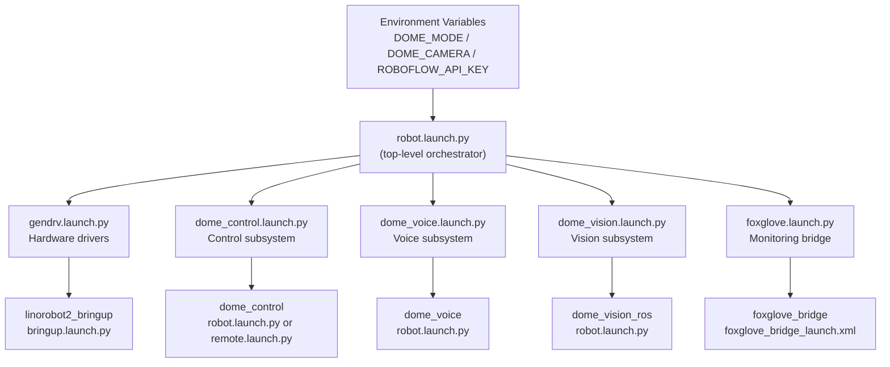

# dome2: A Meta-Package and the BetterLaunch Abstraction

## What dome2 Is

`dome2` is not a ROS2 node package — it contains no nodes, no publishers, no subscribers. Its sole purpose is **orchestration**: it holds the launch files that bring the robot's subsystems to life in the right combination, with the right configuration.

Think of it as the conductor of an orchestra. The musicians (nodes) live in `dome_control`, `dome_voice`, `dome_vision_ros`, and `linorobot2_bringup`. `dome2` decides which musicians play, when, and with what sheet music.

## The BetterLaunch Abstraction

Raw ROS2 launch files are verbose Python — you construct `LaunchDescription` objects, chain `IncludeLaunchDescription` actions, resolve paths manually. `dome2` uses a thin wrapper library called `better_launch` that hides this ceremony.

Every launch file in `dome2` follows the same three-line pattern:

```python
from better_launch import BetterLaunch, launch_this

@launch_this(ui=True)
def start_nav():
    bl = BetterLaunch()
    bl.include("some_package", "some.launch.py", arg=value)
```

The `@launch_this` decorator transforms `start_nav()` into a valid ROS2 launch description. The `ui=True` flag enables a terminal UI that shows node status during launch — useful for debugging startup failures without scrolling through log spam.

`BetterLaunch` provides two key methods:

- **`bl.include(package, launch_file, **kwargs)`** — includes another launch file by ROS2 package name and filename, passing keyword arguments as launch arguments. This replaces several lines of path resolution and `IncludeLaunchDescription` boilerplate.
- **`bl.find(package, filename)`** — resolves the installed path of a file within a ROS2 package's `share/` directory. Used when a downstream launch file needs an explicit path rather than a package reference.

## DOME_MODE: Robot vs Remote

A recurring pattern across all launch files is the `DOME_MODE` environment variable:

```python
mode = os.environ.get("DOME_MODE", "robot")
```

This variable controls which hardware profile the robot runs. Two modes exist:

| Mode | Meaning |
|------|---------|
| `robot` | Running directly on the robot hardware (Raspberry Pi) |
| `remote` | Running on a remote machine, controlling the robot over the network |

The default is `robot` — if the variable is unset, assume you're on the hardware. This is a deliberate safe default: forgetting to set `DOME_MODE=remote` on a dev laptop means you get a failed launch (missing hardware) rather than silently running in a degraded mode that looks like it's working.

Each subsystem interprets `DOME_MODE` independently, which allows selective subsystem launches. Voice, for instance, enforces that it only runs in `robot` mode:

```python
if not (mode == "robot"):
    print("Robot mode required because voice control is only onboard. Exiting")
```

This isn't a hard crash — it's a print and implicit no-op. The design assumes that including a subsystem that can't run in the current mode is not a fatal error for the overall system.

## System Composition Diagram



Each `dome2` launch file is a thin delegation layer — it reads the environment, validates preconditions, then hands off to the actual subsystem package. This keeps subsystem complexity inside the subsystem, and keeps `dome2` focused on wiring.
