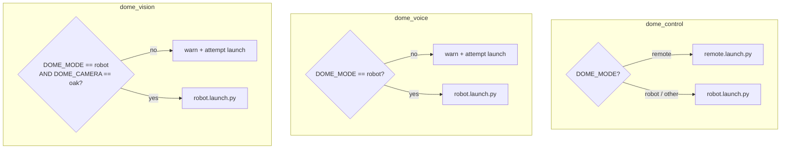

# Subsystem Launch Files: Control, Voice, and Vision

The three subsystem launch files — `dome_control.launch.py`, `dome_voice.launch.py`, and `dome_vision.launch.py` — share a structure: read environment, validate preconditions, delegate to the subsystem package. Each enforces different constraints based on what the subsystem requires.

## dome_control: Mode-Aware Control

```python
mode = os.environ.get("DOME_MODE", "robot")

@launch_this(ui=True)
def start_nav():
    bl = BetterLaunch()
    if mode == "remote":
        launch_file = "remote.launch.py"
    else:
        launch_file = "robot.launch.py"
    print(f"********** Launching control with mode {mode} and launch file {launch_file} ")
    bl.include("dome_control", launch_file)
```

Control is the only subsystem that supports both `robot` and `remote` modes. This reflects a real architectural split: when running on the robot, the control stack runs locally and communicates directly with hardware. When running on a remote machine, a different launch file (`remote.launch.py`) starts a subset of nodes — likely those that generate commands and display state, without the low-level hardware interface.

The explicit print statement (`**********`) is a runtime diagnostic — easy to spot in log output when debugging launch sequences. It signals which branch was taken.

Notice the branching logic: `remote` triggers the remote file, *anything else* (including `robot`) triggers `robot.launch.py`. This means an unknown `DOME_MODE` value silently falls through to robot mode. Whether this is intentional or a latent bug depends on whether new modes are anticipated.

## dome_voice: Robot-Only Constraint

```python
mode = os.environ.get("DOME_MODE", "robot")

@launch_this(ui=True)
def start_nav():
    bl = BetterLaunch()
    if not (mode == "robot"):
        print("Robot mode required because voice control is only onboard. Exiting")
    bl.include("dome_voice", "robot.launch.py")
```

Voice is hardware-bound: the microphone and speaker are physical devices on the robot, not accessible remotely. The mode check enforces this constraint — but notice that after the print, `bl.include()` is called unconditionally. In non-robot mode, this will attempt to launch and likely fail when the audio devices are not found.

This is a soft guard, not a hard one. The print serves as a warning for the developer launching manually; the actual failure mode depends on what `dome_voice`'s launch file does when audio hardware is missing.

## dome_vision: Multi-Condition Guard

```python
mode = os.environ.get("DOME_MODE", "robot")
camera = os.environ.get("DOME_CAMERA", "oak")
roboflow = os.environ.get("ROBOFLOW_API_KEY", None)

@launch_this(ui=True)
def start_nav():
    bl = BetterLaunch()
    if not (mode == "robot" and camera == "oak"):
        print("Oak camera and robot mode required. Exiting")
    bl.include("dome_vision_ros", "robot.launch.py")
```

Vision introduces two additional environment variables:

| Variable | Default | Meaning |
|----------|---------|---------|
| `DOME_CAMERA` | `oak` | Camera hardware type; only `oak` (OAK-D) is supported |
| `ROBOFLOW_API_KEY` | `None` | API key for Roboflow model inference; read but not passed to the launch |

The `ROBOFLOW_API_KEY` is read at the module level but never used in the launch logic. It's likely consumed by the vision nodes themselves via the environment — they read it directly rather than receiving it as a launch argument. This is a common pattern for API keys: passing secrets through launch argument chains creates logs; environment variables stay out of logs.

The guard condition requires both `robot` mode AND `oak` camera. An `oak` camera connected to a remote machine doesn't satisfy the constraint — vision processing must happen on the robot where the USB camera is physically attached.

Like voice, the guard is soft: `bl.include()` runs unconditionally after the check.

## Constraint Summary



## Design Observations

**Guards are advisory, not enforced.** All three subsystems print warnings but proceed to `bl.include()` regardless. A stricter design would `return` or `raise` after a failed check. The current pattern relies on the downstream launch failing visibly — which may be acceptable in practice but makes the intent ambiguous.

**Mode inference, not configuration.** Each launch file independently reads `DOME_MODE`. There is no central configuration object passed between launch files. This is consistent with ROS2's process model (each launch file is an independent Python module), but it means adding a new mode requires touching every subsystem file.

**Package naming inconsistency.** Control delegates to `dome_control`, voice to `dome_voice`, but vision delegates to `dome_vision_ros` — not `dome_vision`. The `_ros` suffix suggests the vision package has a naming convention that differs from the others, possibly because the original `dome_vision` name was taken or there is a non-ROS component with that name.
