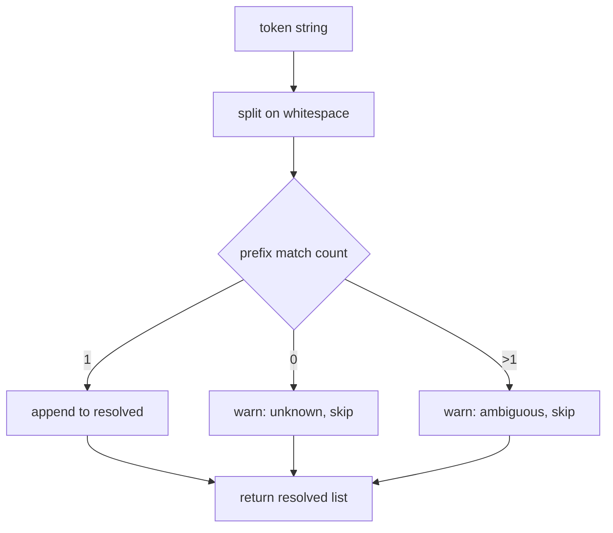

# The Top-Level Orchestrator: robot.launch.py

## What This File Does

`robot.launch.py` is the single entry point for launching dome2. It decides *which*
subsystems to bring up based on a profile (an environment variable that names a token
string), a direct `--options` override, or interactive prompting. The subsystem launch
files it delegates to are intentionally thin; all selection policy lives here.

## Subsystem Registry

Two module-level structures define the available subsystems:

```python
SUBSYSTEMS = ["drivers", "control", "vision", "voice", "foxglove", "nav"]

LAUNCH_FILES = {
    "drivers":  ("dome2", "gendrv.launch.py"),
    "control":  ("dome2", "dome_control.launch.py"),
    "vision":   ("dome2", "dome_vision.launch.py"),
    "voice":    ("dome2", "dome_voice.launch.py"),
    "foxglove": ("dome2", "foxglove.launch.py"),
    "nav":      ("dome2", "dome_nav.launch.py"),
}
```

`SUBSYSTEMS` is an ordered list (display and prompt order). `LAUNCH_FILES` maps each
name to its `(package, launch_file)` tuple. Adding a new subsystem means one entry in
each structure.

## Token Resolution

Users specify subsystems by prefix rather than full name, so `"d c vi"` expands to
`["drivers", "control", "vision"]`. The resolver enforces that each token is
unambiguous:

```python
def resolve_tokens(options_str: str) -> list[str]:
    resolved = []
    for token in options_str.split():
        matches = [s for s in SUBSYSTEMS if s.startswith(token.lower())]
        if len(matches) == 1:
            resolved.append(matches[0])
        elif not matches:
            logging.warning(f"Launch option '{token}' matches no subsystem, skipping")
        else:
            logging.warning(f"Launch option '{token}' is ambiguous: matches {matches}, skipping")
    return resolved
```

Ambiguous and unknown tokens are skipped with a warning rather than raising. The rationale:
a typo in a token string should not prevent the rest of the robot from starting.



## Profile System

A *profile* is an environment variable whose value is a token string. The default
profile is `$DOME_PROFILE`; if unset, it falls back to `"robot"`, meaning it reads
`$robot`.

```python
DEFAULT_PROFILE = os.environ.get("DOME_PROFILE", "robot")
```

In `start_nav`:

```python
if options is not None:
    token_str = options
else:
    token_str = os.environ.get(profile)
    if token_str is None:
        raise ValueError(f"Profile '{profile}': no env var '{profile}' found")
```

`--options` overrides the profile entirely. If neither is available, the function raises
rather than silently launching nothing.

## Interactive Mode

When `--is_interactive` is set, each subsystem is confirmed individually via `click`:

```python
if is_interactive:
    logging.info(f"Profile '{profile}' — confirm each subsystem:")
    for name in SUBSYSTEMS:
        cfg[name] = click.confirm(f"  Launch {name}?", default=cfg[name])
```

The profile or `--options` still runs first to set the defaults; interactive mode lets
the user adjust from that starting point rather than starting from all-off.

## Launch Loop

```python
bl = BetterLaunch()
for name, enabled in cfg.items():
    if enabled:
        pkg, launch_file = LAUNCH_FILES[name]
        bl.include(pkg, launch_file)
```

`cfg` is a `{subsystem: bool}` dict. Iterating it in insertion order (Python 3.7+)
means subsystems launch in the order defined in `SUBSYSTEMS`.

## Design Observations

- **Profile indirection adds one level of naming.** `$DOME_PROFILE=robot` means "read
  `$robot`", not "use the string `robot`". This is non-obvious; the examples in the file
  header are the primary documentation.
- **`options: str = None` should be `str | None`.** Minor style inconsistency with the
  project's type annotation convention.
- **No deduplication in token resolution.** Passing `"d drivers"` would launch drivers
  twice. This is unlikely in practice but worth noting.
- **`click` dependency for interactive mode.** If `click` is not installed, interactive
  mode crashes at runtime rather than at import time. Consider a lazy import or a
  runtime check with a clear error.
