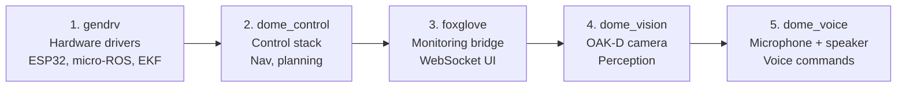

# The Top-Level Orchestrator: robot.launch.py

## What This File Does

`robot.launch.py` is the single entry point for launching the complete robot. It includes every other `dome2` launch file in sequence, bringing up all subsystems together.

```python
@launch_this(ui=True)
def start_nav():
    bl = BetterLaunch()
    bl.include("dome2", "gendrv.launch.py")
    bl.include("dome2", "dome_control.launch.py")
    bl.include("dome2", "foxglove.launch.py")
    bl.include("dome2", "dome_vision.launch.py")
    bl.include("dome2", "dome_voice.launch.py")
```

Five lines, five subsystems. No logic, no conditions — just composition.

## Startup Order

The includes appear in a deliberate sequence:



Hardware drivers first — the control stack needs odometry and IMU data from the ESP32 before it can do anything useful. Foxglove comes early so the monitoring UI is available as subsequent subsystems start, making it easier to observe their initialization. Vision and voice come last as they are the highest-level, most optional subsystems.

However, ROS2 launch does not guarantee sequential startup in the sense of "wait for subsystem A to be fully ready before starting subsystem B." All included launch files are composed into a single `LaunchDescription` and executed by the ROS2 launch framework. The ordering here controls the order in which processes are *spawned*, not the order in which they reach operational readiness. Nodes that need other nodes must handle startup races themselves (typically through ROS2's lifecycle nodes or retry logic).

## What's Not In This File

`robot.launch.py` contains no environment variable reads. It defers all mode logic to the individual subsystem launch files. This is the correct separation: the orchestrator's job is composition, not policy.

There is no error handling if a subsystem fails to launch. A single `bl.include()` failure will propagate up and abort the remaining includes — this is the expected ROS2 launch behavior. The `ui=True` flag on `@launch_this` makes it easier to spot which process failed.

## How to Use

Full robot bringup on the robot hardware:

```bash
DOME_MODE=robot ros2 launch dome2 robot.launch.py
```

Remote machine (no hardware, no voice, degraded control):

```bash
DOME_MODE=remote ros2 launch dome2 robot.launch.py
```

Or launch individual subsystems for development:

```bash
# Only hardware + control (no vision/voice)
DOME_MODE=robot ros2 launch dome2 gendrv.launch.py &
DOME_MODE=robot ros2 launch dome2 dome_control.launch.py
```

## Improvement Opportunities

**No health checks between subsystems.** The orchestrator could benefit from `ReadinessGate`-style conditions (available in newer ROS2 versions) that delay starting a subsystem until its dependencies advertise readiness on specific topics.

**Unconditional includes.** If you want to bring up the robot without voice (e.g., for a silent demo environment), you must edit this file. A more flexible design would accept launch arguments (`with_voice:=false`) that gate individual `bl.include()` calls.

**No restart policy.** If the vision node crashes, it stays down. ROS2 launch supports `respawn=True` on node actions; a production orchestrator might want this for critical subsystems like control.
