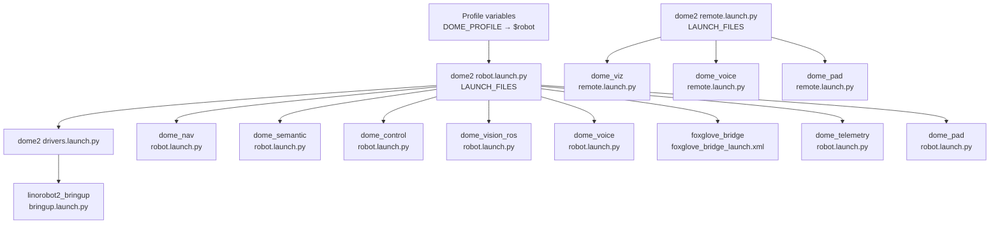

# dome2: A Meta-Package and the better_launch Abstraction

## What dome2 Is

`dome2` contains no publishers, subscribers or nodes. It is **orchestration**: launch files that bring the robot's subsystems up in the right combination.

Think of it as a conductor. The musicians (nodes) live in `dome_control`, `dome_vision_ros`, `dome_voice` and the rest. dome2 decides which of them play.

## better_launch

Stock ROS 2 Python launch files are ceremony: `LaunchDescription`, `DeclareLaunchArgument`, `IncludeLaunchDescription`, substitutions. DOME uses **better_launch**, where a launch file is a decorated function:

```python
from better_launch import BetterLaunch, launch_this

@launch_this(ui=True)
def start_nav():
    bl = BetterLaunch()
    bl.include("dome_control", "robot.launch.py")
```

- **`@launch_this`** turns the function into the launch entry point. Its **signature is the command line**: each parameter becomes a `--flag`.
- **`ui=True`** brings up a terminal UI that shows each node's state and lets you stop the launch.
- **`bl.include(package, file, **kwargs)`** includes another launch file. Python, XML and YAML launch files all work, which is how dome2 includes `foxglove_bridge_launch.xml` directly.
- **`bl.find(package, file)`** resolves a file in a package's installed `share/` directory.

### A constraint that shapes every signature

better_launch reads the arguments by **parsing the source**, not by running it. Defaults must therefore be literals, and annotations must be types click can build an option from. Chapter 4 shows how the launchers work around that.

## Composition



Each arrow from a launcher is one row of its `LAUNCH_FILES` table. **Only one of the targets is a dome2 file**: the driver bringup, because dome2 owns that configuration.

## Robot versus remote

There used to be one launcher and a `DOME_MODE` environment variable. Each wrapper read it and decided what to do on which computer.

Now **the launcher is the mode**:

- `robot.launch.py` lists what runs on the Pi.
- `remote.launch.py` lists what runs on the remote computer.

A subsystem that can't run on a computer simply isn't in that computer's table. There is no variable to forget and no guard to keep in sync.

## Where things are checked

`test/test_launch_conventions.py` enforces the convention across every DOME package checked out next to dome2:

- the file header, usage lines and docstrings
- literal defaults
- no cross-package includes outside dome2
- every `LAUNCH_FILES` target exists
- no doc mentions a deleted launch file

## Observations

1. **The tables depend on other packages' file names.** Renaming a package's launch file breaks dome2. The existence test catches it, but only for packages checked out on that computer.
2. **Forwarding is by name, implicitly.** better_launch hands the launcher's arguments to every included file that declares the same name, so `--map_name` reaches both `slam` and `semantic` with no code in dome2. The price is that a name must mean the same thing in every package; a convention test checks the names and types.
3. **Forwarded arguments are all-or-nothing.** There is no way to give one subsystem an argument another also declares, e.g. a different `map_name` for SLAM and for the semantic map.
