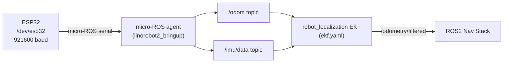

# Hardware Bringup: drivers.launch.py

## The Role of drivers.launch.py

`drivers.launch.py` is the lowest-level launch file in `dome2`. It starts the hardware drivers — the nodes that talk directly to physical devices. Everything else in the robot depends on what this file brings up.

It was called `gendrv.launch.py` until 2026-11-19 (TF05.4), after the robot's firmware configuration; the new name matches its subsystem, `drivers`. The actual work is delegated to `linorobot2_bringup`, a community ROS2 package for differential-drive robots.

## Path Resolution

Two external config files must be resolved to absolute paths before being passed as launch arguments:

```python
urdf_path = bl.find("dome2", "dome3.urdf")
ekf_config_path = bl.find("dome2", "ekf.yaml")
```

These files live in the `dome2` package itself. There is no mode guard: the drivers are only listed in `robot.launch.py`, so they never start on the remote computer. `bl.find()` resolves them to the installed share path at launch time rather than at package build time, so the paths survive `colcon build` reinstalls.

## The linorobot2_bringup Arguments

```python
bl.include(
    "linorobot2_bringup",
    "bringup.launch.py",
    rviz=False,
    sim=False,
    base_serial_port="/dev/esp32",
    micro_ros_baudrate="921600",
    madgwick="false",
    orientation_stddev="0.01",
    joy="false",
    urdf=urdf_path,
    ekf_config_path=ekf_config_path,
)
```

Each argument reflects a deliberate hardware decision:

| Argument | Value | Why |
|----------|-------|-----|
| `rviz` | `False` | No display on the robot; visualization runs remotely via Foxglove |
| `sim` | `False` | Real hardware, not Gazebo |
| `base_serial_port` | `/dev/esp32` | Robot base MCU is an ESP32, connected via USB serial with a udev rule that gives it this stable name |
| `micro_ros_baudrate` | `921600` | High baud rate for micro-ROS; must match firmware setting |
| `madgwick` | `false` | Madgwick filter disabled — IMU fusion is handled by the EKF instead |
| `orientation_stddev` | `0.01` | Low orientation noise assumption; tuned for the robot's IMU quality |
| `joy` | `false` | Joystick input disabled; robot is commanded via software, not a gamepad |
| `urdf` | resolved path | Robot model used by `robot_state_publisher` |
| `ekf_config_path` | resolved path | Extended Kalman Filter config for odometry + IMU fusion |

## The ESP32 / micro-ROS Architecture



The ESP32 runs micro-ROS firmware that publishes wheel odometry and IMU data. The `linorobot2_bringup` launch starts a micro-ROS agent that bridges the serial connection into ROS2 topics. The EKF then fuses odometry and IMU to produce a filtered pose estimate used by navigation.

Disabling Madgwick (`madgwick=false`) means orientation from the IMU goes directly into the EKF rather than through a separate complementary filter — the EKF itself handles sensor fusion, which is cleaner when the EKF is already tuned for the IMU's noise characteristics.

## Observations

1. **The serial port and baud rate are hard-coded.** They match the ESP32's udev rule and firmware; a second robot would need them as arguments.
2. **It receives the launcher's arguments too.** better_launch passes `--map_name` and the rest to `linorobot2_bringup` as launch arguments, which it ignores. Harmless, but surprising in its logs.
