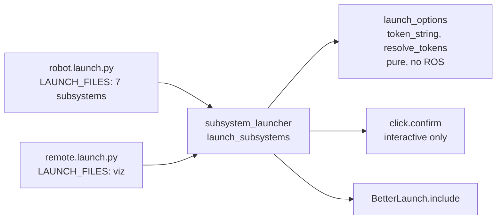
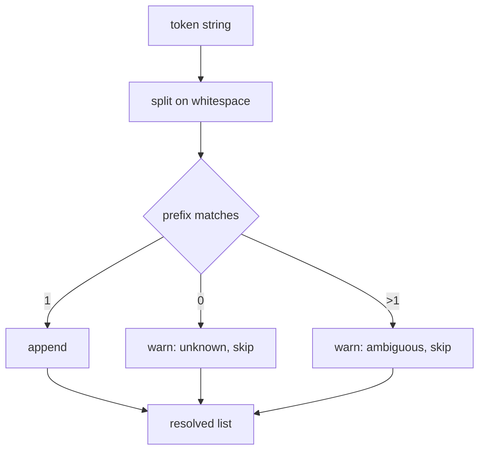

# The Orchestrators: robot.launch.py and remote.launch.py

## What These Files Do

dome2 has **two top-level launchers**, one per computer:

- **`robot.launch.py`** runs on the Pi and brings up drivers, control, vision, voice, foxglove, battery telemetry and the Yellow Pad.
- **`remote.launch.py`** runs on the remote computer (the VM on the Mac mini). For now it brings up only `dome_viz`'s map view.

Both decide *which* subsystems to start from a **profile** (an environment variable naming a token string), a direct **`--options`** override, or **interactive** yes/no confirmation. They share all of that logic, so each launcher is little more than a table.

## How the Pieces Fit

The selection policy lives in two small modules in the `dome2` Python package. The launch files only declare what exists.



The split is deliberate:

- **`launch_options`** is *pure*: no ROS, no `click`, no environment reads of its own. It takes the environment as a mapping argument, so tests pass a plain dict.
- **`subsystem_launcher`** is the *adapter*: it reads `os.environ`, prompts, and calls `better_launch`.
- **The launch files** hold only data and the decorated entry point.

Before this split, `robot.launch.py` held everything. A second launcher would have meant copying the resolver, which is exactly the kind of drift the shared module prevents.

## The Subsystem Tables

Each launcher declares one **ordered dict** from subsystem name to `(package, launch file)`:

```python
LAUNCH_FILES = {
    "drivers": ("dome2", "gendrv.launch.py"),
    "control": ("dome2", "dome_control.launch.py"),
    ...
    "battery": ("dome_telemetry", "robot.launch.py"),
    "yellow": ("yellow_pad", "yellow_pad.launch.py"),
}

SUBSYSTEMS = list(LAUNCH_FILES)
```

```python
LAUNCH_FILES = {
    "viz": ("dome_viz", "remote.launch.py"),
}
```

`SUBSYSTEMS` is **derived** from the dict instead of being a second hand-kept list. Dict insertion order (guaranteed since Python 3.7) gives the prompt order and the include order, so adding a subsystem is now one line.

A few entries point **straight at other packages' launch files** instead of a thin `dome2` wrapper (chapter 3):

- **`battery`** and **`yellow`** on the robot, so each can be toggled on its own. `--options "d b"` gives drivers plus battery telemetry.
- **`viz`** on the remote, which uses `dome_viz`'s own `remote.launch.py` unchanged.

Nav/SLAM is not in either table. It is launched separately, per mode, from `dome_nav`, because it doesn't fit the on-or-off model.

## Token Resolution

Users name subsystems by **prefix**, so `"d c vi"` expands to `["drivers", "control", "vision"]`. The resolver now takes the subsystem list as an argument, which is what lets both launchers share it:

```python
def resolve_tokens(options_str: str, subsystems: list[str]) -> list[str]:
    resolved = []
    for token in options_str.split():
        matches = [s for s in subsystems if s.startswith(token.lower())]
        if len(matches) == 1:
            resolved.append(matches[0])
        elif not matches:
            logging.warning(...)   # unknown: skip
        else:
            logging.warning(...)   # ambiguous: skip
```

Each token must match **exactly one** name. This is *unique-prefix matching*, the same idea as abbreviated command names in many shells and CLIs. The minimum unambiguous prefix depends on the table: on the robot `v` is ambiguous (vision, voice), while on the remote `v` means `viz`.

Unknown and ambiguous tokens are **skipped with a warning** rather than raising. A typo in one token shouldn't keep the rest of the robot from starting.



## Profiles

A **profile** is an environment variable whose value is a token string. `token_string` picks the source:

```python
def token_string(profile: str, options: str, environ: Mapping[str, str]) -> str:
    if options:
        return options
    token_str = environ.get(profile)
    if token_str is None:
        raise ValueError(f"Profile '{profile}': no env var '{profile}' found")
    return token_str
```

- **`--options` wins** outright.
- Otherwise the profile's variable is read. **A missing variable raises**: launching nothing silently would look like a hardware fault.
- An *empty* variable is a legitimate empty selection, so it returns `""`, not an error.

### When neither is given: list and shut down

In practice the launcher never lets that raise reach the user. `launch_subsystems` checks the *both missing* case first, says what it can launch, and shuts down without launching anything:

```python
if not options and profile not in os.environ:
    logging.error(missing_profile_message(profile, subsystems))
    BetterLaunch().shutdown("no subsystems selected")
    return
token_str = token_string(profile, options, os.environ)
```

- **The pure layer keeps its contract.** `token_string` still raises on a missing profile. The decision to stop lives in the adapter, which is the only layer allowed to touch the process or a terminal.
- **`missing_profile_message`** is pure and tested. It names the profile it looked for, lists the subsystems, and suggests either `--options "<first letter>"` or `export <profile>="<first letter>"`.
- **Why it doesn't ask.** An earlier version used `click.prompt` here. Under `@launch_this(ui=True)`, better_launch's terminal UI owns the screen, so the prompt never appeared and the launch just hung. Stopping with the list is simpler and always visible. It stops even with `--is_interactive`, for the same reason.
- **Why not `sys.exit`.** Under the UI, better_launch runs the launch function in a worker thread. A `SystemExit` there ends only that thread; the UI kept running and asked "Shutdown nodes and quit?". Calling `shutdown()` on the `BetterLaunch` instance instead lets the UI's `spin()` return at once, and the UI quits by itself. The cost: the process exits with status 0, not 1.

Each launcher has its own default profile name, read once at import:

```python
DEFAULT_PROFILE = os.environ.get("DOME_PROFILE", "robot")          # robot
DEFAULT_PROFILE = os.environ.get("DOME_REMOTE_PROFILE", "remote")  # remote
```

That is **two levels of naming**: `DOME_PROFILE=robot` means "read `$robot`", not "use the string `robot`".

## Why the Defaults Are Literal `""`

The entry points look odd at first:

```python
@launch_this(ui=True)
def start_remote(profile: str = "", options: str = "", is_interactive: bool = False):
    launch_subsystems(profile or DEFAULT_PROFILE, options, is_interactive, LAUNCH_FILES)
```

**`better_launch` reads launch arguments by parsing the source**, not by running it. A default such as `profile: str = DEFAULT_PROFILE` is a *name*, which a static parser can't evaluate. So the signature uses a literal `""`, and the body substitutes the real default.

Two related constraints are pinned by tests:

- every default is an `ast.Constant` (checked by parsing the file), and
- every annotation is a plain type, because `better_launch` hands it straight to `click.Option(type=...)`, which can't build an option from a union like `str | None`.

## Interactive Mode and the Launch Loop

`launch_subsystems` runs the steps in order:

```python
active = set(resolve_tokens(token_str, subsystems))
cfg = {name: name in active for name in subsystems}

if is_interactive:
    for name in subsystems:
        cfg[name] = click.confirm(f"  Launch {name}?", default=cfg[name])

bl = BetterLaunch()
for name, is_enabled in cfg.items():
    if is_enabled:
        bl.include(*launch_files[name])
```

- The resolved names go into a **set**, then into a `{name: bool}` dict keyed by the table. A token given twice (`"d drivers"`) therefore launches once, and the **table order, not the token order**, decides the include order.
- **Interactive mode starts from the profile's selection**, not from all-off, so the user only flips what differs.

## Observations

- **Profile indirection is still the least obvious part.** `DOME_PROFILE` naming another variable trips people up. The exit message with its `export` hint now explains it at the moment it matters, rather than only in the launch files' header examples.
- **Entries depend on other packages' file names.** `remote.launch.py`'s only entry relies on `dome_viz`'s `remote.launch.py` (renamed from `view.launch.py` on 2026-11-19). `test_launch_conventions.py` now checks that every `LAUNCH_FILES` target exists in the source tree, but only for packages checked out next to dome2.
- **`package.xml` serves both computers.** It exec-depends on robot-only packages (`yellow_pad`, `dome_telemetry`), so `rosdep install` on the remote computer will complain even though nothing there needs them.
- **`logging` uses the root logger** (ruff's LOG015 is waived in `ruff.toml`) because pytest's `caplog` here didn't reliably capture named loggers. A module logger would be cleaner if that is revisited.
