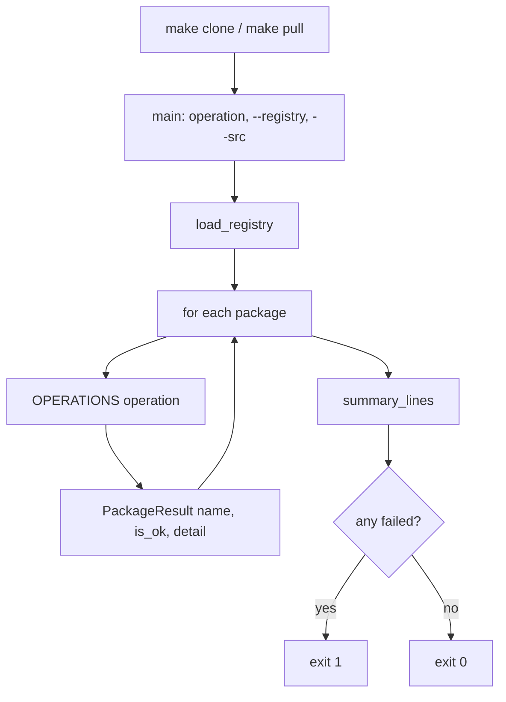

# The Stack Tools: stack_registry and stack_ops

## What These Modules Do

dome2 is also the **hub for the whole DOME stack**: a dozen repos that live side by side in `~/ros2_ws/src`, on both the robot and the remote computer. Two modules turn that into something you can act on:

- **`stack_registry`** loads `stack/packages.yaml`, the single list of DOME packages, and validates it.
- **`stack_ops`** is a small command-line tool that runs one git operation across every registered package. It backs `make clone` and `make pull`.

The typical use on a fresh computer is three commands:

```
git clone git@github.com:Boston-Robot-Hackers/dome2.git ~/ros2_ws/src/dome2
cd ~/ros2_ws/src/dome2 && make clone     # clones the other 11 next to it
make pull                                # later: fast-forward all 12
```

## The Registry as Data

Each entry has three fields:

```yaml
- name: dome_viz
  repo: git@github.com:Boston-Robot-Hackers/dome_viz.git
  runs_on: remote
```

**`runs_on` is descriptive, not a filter.** It records where a package *runs* (`robot`, `remote` or `both`). Both computers keep *every* package checked out, so the tools ignore it. An earlier version selected packages by a host role; it was dropped as soon as the real need was clear: the whole stack, everywhere.

In Python each entry becomes a frozen dataclass:

```python
@dataclass(frozen=True)
class StackPackage:
    name: str
    repo: str
    runs_on: str
```

*Frozen* makes the values hashable and stops anything downstream from editing them, which fits their role as validated, trusted input.

## Validate Once, at the Boundary

The registry is a **hand-edited file**, so it is checked in one place, at load time, and trusted afterwards. `parse_registry` is split from `load_registry` so the checks can be tested on plain dicts without touching the disk:

```python
def load_registry(registry_path: Path) -> list[StackPackage]:
    return parse_registry(yaml.safe_load(registry_path.read_text()))
```

The checks, each raising `RegistryError` naming the bad entry:

1. **The list is non-empty.** `None` (an empty file), `{}` and `{"packages": []}` all fail; an empty registry is always a mistake.
2. **Every field is present** and non-empty.
3. **`runs_on` is one of** `robot`, `remote`, `both`.
4. **Names are unique.** A duplicate would make the two entries fight over one directory.

`yaml.safe_load` is used rather than `yaml.load` because it only builds plain data (dicts, lists, strings), never arbitrary Python objects.

## One Engine, Two Operations

`stack_ops` runs one *operation* across all packages. An operation is a function from a package and the `src/` directory to a result:

```python
OPERATIONS: dict[str, Callable[[StackPackage, Path], PackageResult]] = {
    "clone": clone_package,
    "pull": pull_package,
}
```

This *dispatch table* replaces an if-chain: argparse's `choices` come from its keys, and adding an operation is one function plus one entry.



Each package produces exactly one `PackageResult`, so **one failure never stops the others**. The summary names every failure, and the exit status tells `make` and scripts whether the run was clean.

## The Two Operations

The operations differ mainly in how they treat a missing directory:

```python
def pull_package(package, src_dir):
    package_dir = src_dir / package.name
    if not package_dir.is_dir():
        return PackageResult(package.name, False, "not checked out; run: make clone")
    return run_git(package.name, ["-C", str(package_dir), "pull", "--ff-only"])

def clone_package(package, src_dir):
    package_dir = src_dir / package.name
    if package_dir.exists():
        return PackageResult(package.name, True, "already present")
    return run_git(package.name, ["clone", package.repo, str(package_dir)])
```

- **`pull` never clones.** A missing package is a failure that points to `clone`, so a pull can't quietly add repos.
- **`clone` never touches what exists.** Anything at the path counts as present, whether a checkout or a stray file, and is reported, not "fixed". That makes `clone` *idempotent*: running it twice is harmless.
- **`--ff-only`** means a pull either fast-forwards or fails. It never creates a merge commit in a package with local work; that is left to a person.

## Turning git Output into One Line

`run_git` runs git without a shell and reduces its output to one line per package:

```python
lines = (completed.stdout + completed.stderr).strip().splitlines()
detail = (lines[0] if is_ok else lines[-1]) if lines else ""
```

The asymmetry is the point. **On success git's first line says what happened** (`Updating 1a2b..3c4d`, `Already up to date.`, `Cloning into ...`); **on failure the error is the last line** (`fatal: Not possible to fast-forward`). The first version always took the last line, which printed `create mode 100644 ...` for a package that had just updated.

The command is passed as an argument list, not a string, so repo URLs and paths are never interpreted by a shell.

## Testing Without git

The tests replace `subprocess.run` with a fake that records each git argument list and fails on request:

- clone builds `["clone", <repo>, <src>/<name>]` for exactly the missing packages;
- pull uses `--ff-only` and skips git entirely for a missing package;
- one failing package still lets the rest run, and the exit status becomes 1.

A separate test reads the real `packages.yaml` and checks that **every package appears in the spec's table and in `stack/README.md`**, so the three lists can't drift apart unnoticed.

## Observations

- **Git runs one package at a time.** Twelve serial pulls over Wi-Fi take a few seconds each. A thread pool would cut that a lot, since each git call is I/O-bound and independent.
- **A failed `clone` can leave a partial directory**, which the next `clone` would then call "already present". Removing the target after a failed clone, or treating a directory without `.git` as a failure, would close that gap.
- **`pull` doesn't say *why* a package is dirty or diverged.** Showing `git status --short` for a failed package would save a manual `cd`.
- **`--src ..` assumes dome2 lives in the workspace `src/`.** That is true by convention; the Makefile states it explicitly rather than guessing, but it is still an assumption about layout.
